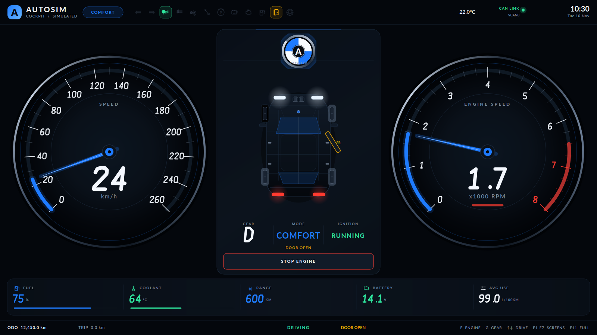
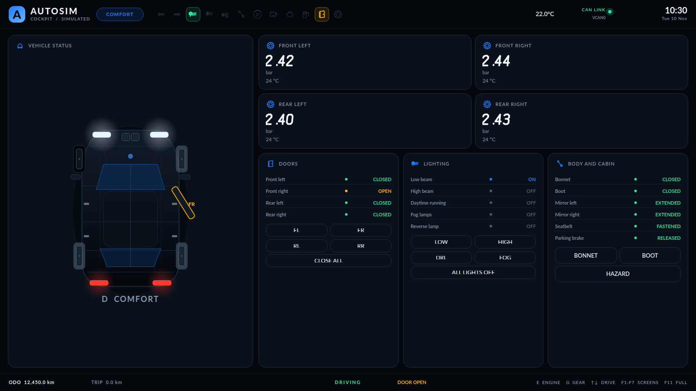
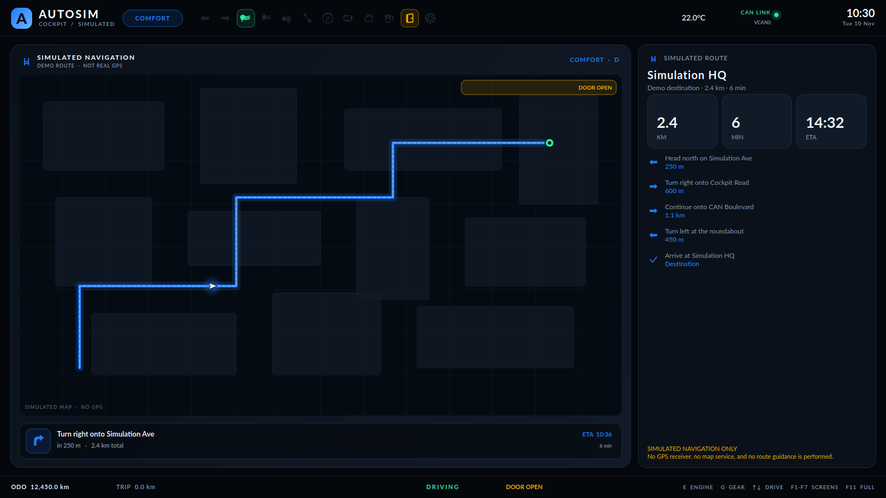
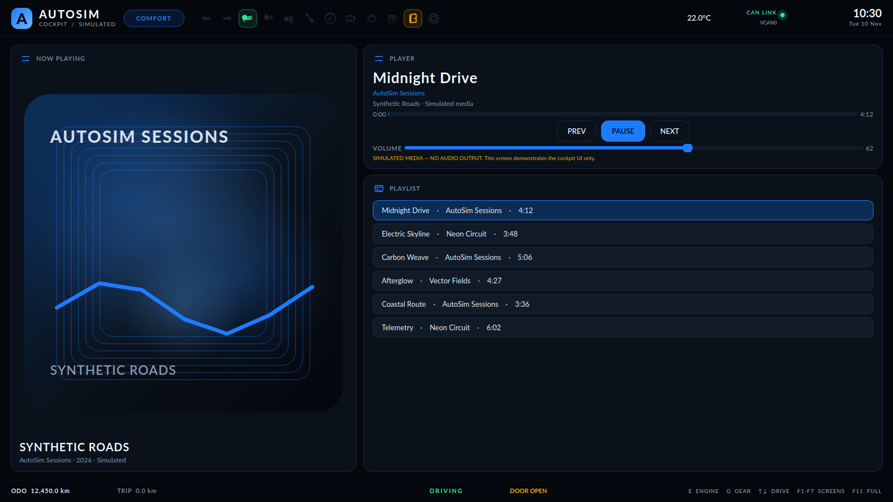
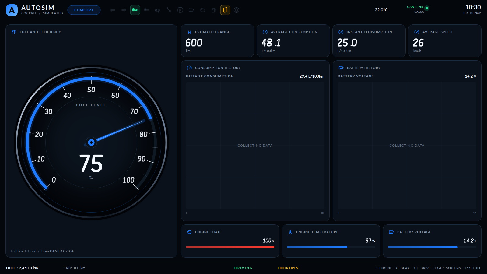
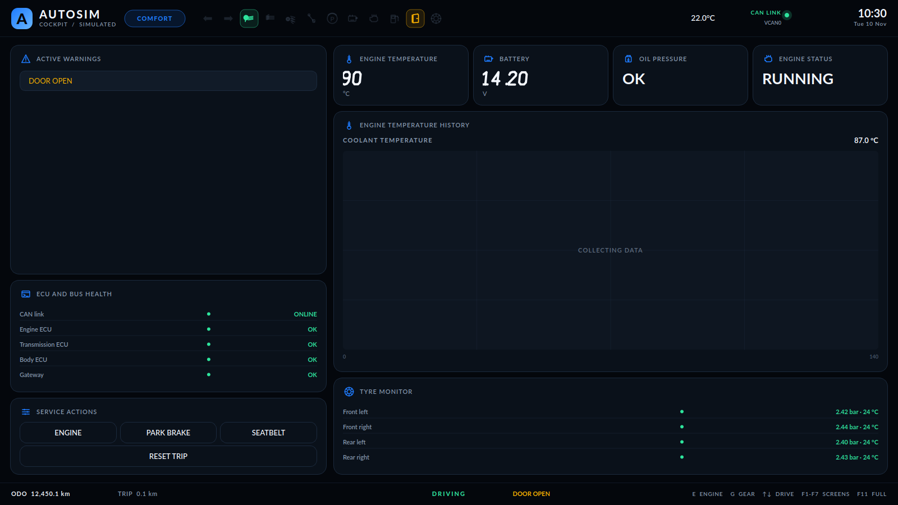
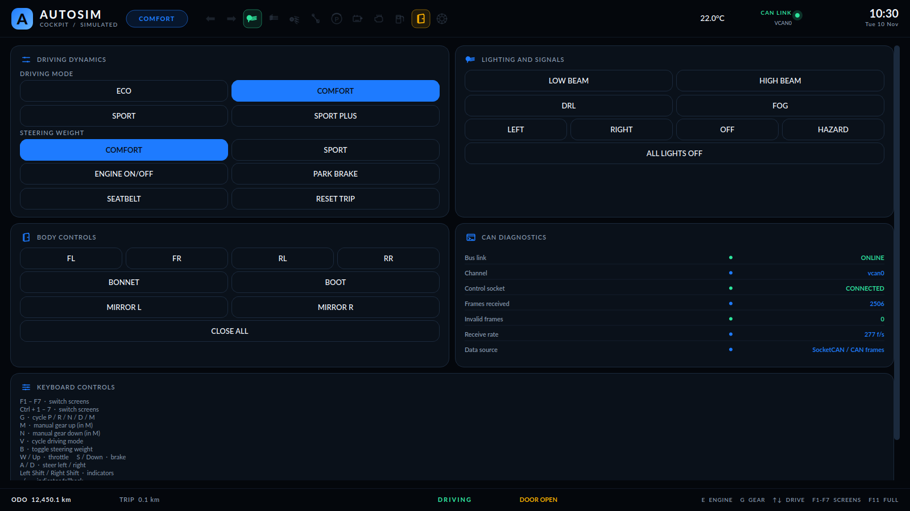
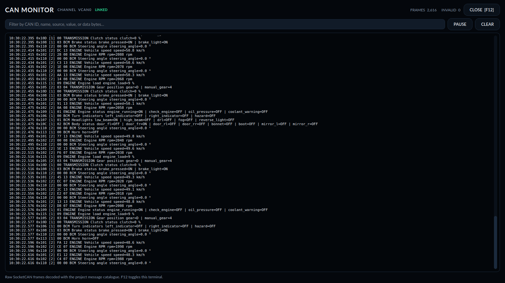

# Automotive Dashboard Simulator

A complete, original Linux automotive cockpit simulator. A vehicle simulation
process drives physical state, ECUs publish it as CAN frames, and a separate
PySide6 dashboard decodes those frames to render a seven-screen cockpit with
live gauges, telltales, diagnostics, and a CAN monitor.



## Project introduction

Automotive Dashboard Simulator (AUTOSIM) is a self-contained vehicle and
dashboard simulation for Linux. It demonstrates how a simulated vehicle, a set
of electronic control units (ECUs), a CAN bus, and a Qt-based dashboard
dashboard interact. The simulator and the dashboard are separate processes that
communicate exclusively over CAN frames (SocketCAN/vcan0 by default) and a
Unix-domain control socket for driver inputs.

The project is intended for learning, prototyping, and demonstration of
automotive embedded software concepts: CAN framing, ECU gateway validation,
vehicle physics, dashboard rendering, and live bus monitoring.

## Project objectives

- Simulate vehicle behaviour (ignition, acceleration, braking, steering,
  clutch, gear selection, fuel, temperature, battery, tyres, lighting, body
  state).
- Publish vehicle state as CAN frames through ECUs and a validating gateway.
- Render a multi-screen cockpit dashboard from decoded CAN frames only.
- Provide live CAN monitoring and on-bus signal decoding.
- Offer keyboard and control-client driving inputs with safety interlocks.
- Run entirely in-process for automated testing (python-can virtual bus) and
  end-to-end on SocketCAN (vcan0).

## Main features

- Simulated vehicle: ignition, throttle, brake, clutch, steering, automatic and
  manual gears, engine RPM, temperature, fuel use, battery charging, tyre
  pressure/temperature, steering weight, indicators, lighting, and body state.
  The engine starts OFF and must be started before driving.
- Isolated ECU publishing: engine, transmission, and body ECUs send through a
  validating gateway. The gateway enforces message ownership, rate limits,
  signal ranges, and DLC before transmitting.
- Real CAN transport: Linux SocketCAN (`vcan0`) by default. The python-can
  virtual backend is used in-process by the automated tests.
- Dashboard consumes **only decoded CAN frames**. It never imports
  `vehicle.*`.
- Separate simulator/dashboard processes with Unix-socket JSON-lines controls.
- Seven screens: cockpit, vehicle, navigation, media, energy, service, settings.
- Mode-reactive themes: `ECO`, `COMFORT`, `SPORT`, and `SPORT PLUS`.
- Live CAN monitor with filtering, pause, clear, frame counts, and link status.
- Premium black cockpit with speedometer/tachometer, central roundel and
  vehicle status, ignition start/stop button, metric strip, and fading system
  notifications.
- Keyboard driving controls, Shift-key indicators, fullscreen, and mouse
  actions for body/lighting/dynamics.
- Logging: rotating CAN CSV log and security/event log.
- Automated test suite covering CAN encoding/decoding, simulation, ignition and
  parking-brake interlocks, model, controls, and offscreen UI widgets.
- Programmatically drawn graphics, no external image assets.

## Screenshots

| Screen | Preview |
| --- | --- |
| Cockpit |  |
| Vehicle |  |
| Navigation |  |
| Media |  |
| Energy |  |
| Service |  |
| Settings |  |
| CAN monitor |  |

Regenerate them headlessly with:

```bash
.venv/bin/python tools/generate_screenshots.py
```

## Technology stack

- Language: Python 3.10+
- GUI framework: PySide6 (Qt for Python)
- CAN library: python-can (SocketCAN and virtual backends)
- Testing: pytest
- Runtime: Linux (SocketCAN / vcan0 for end-to-end; python-can virtual bus for tests)
- Build/launcher: Bash (`run.sh`, `setup_vcan.sh`, `teardown_vcan.sh`)

## Software architecture

The project deliberately separates simulation from presentation:

1. **Simulator** (`python -m vehicle.simulator`)
   - Owns all vehicle state and physical behaviour.
   - Owns the ECUs, gateway, CAN sender, CAN logger, security monitor, and
     control server.
   - Never imports PySide6 or any `dashboard.*` module.
2. **Dashboard** (`python main.py`)
   - Owns Qt widgets, rendering, themes, navigation, and the CAN monitor.
   - Owns a CAN receiver and its own model of received data.
   - Never imports `vehicle.*`. Commands are sent over a Unix socket.
3. **Optional external tools**
   - `candump`/`can-utils` for raw bus observation.
   - `tools/control_cli.py` for direct simulator controls.
   - `tools/generate_screenshots.py` for headless rendering.

Vehicle data crosses the boundary only as CAN frames. The control channel is
only for simulated driver inputs and body/settings actions; it is not a
backdoor for dashboard data.

```text
┌─────────────────────────────┐        CAN frames        ┌───────────────────────┐
│  Simulator process          │  ───────────────────────▶ │  Dashboard process    │
│                             │          vcan0            │                       │
│  VehicleState ── Physics    │                           │  CanBusSource         │
│        │                    │                           │       │               │
│        ├─ EngineECU         │                           │  CAN decoder          │
│        ├─ TransmissionECU   │                           │       │               │
│        └─ BodyECU           │                           │  VehicleModel         │
│              │              │                           │       │               │
│         GatewayECU ─────────┼── CAN sender/logger       │  VehicleSnapshot      │
│              │              │                           │       │               │
│        SecurityMonitor      │                           │  Screens + monitor    │
│                             │                           │                       │
│  ControlServer ◀────────────┼──── JSON lines over ──────┼── ControlClient       │
│  (Unix socket)              │     Unix domain socket    │                       │
└─────────────────────────────┘                           └───────────────────────┘
```

The dashboard has its own `ControlClient` implementation so the UI process can
stay independent of the simulator package and its dependencies.

More detail: [docs/ARCHITECTURE.md](docs/ARCHITECTURE.md).

## Vehicle simulation architecture

The simulator runs at approximately 50 Hz, with a capped `dt` of 50 ms:

1. Drain the command queue and apply commands through `VehicleController`.
2. Decay stale held inputs if no heartbeat has arrived for 2 seconds.
3. Step `VehiclePhysics` on `VehicleState`.
4. Poll each ECU; each ECU transmits due messages through `GatewayECU`.
5. Repeat until SIGINT/SIGTERM or `--duration` elapses.

Physics highlights:

- Speed in km/h; quadratic drag scaled so the model tops out near 260 km/h.
- `D` uses automatic gear selection with up/down thresholds. `M` uses the
  manual gear index, controlled by `gear_next`/`gear_prev`.
- Acceleration limited by throttle, drag, rolling resistance, brake, and
  emergency brake.
- RPM derived from wheel speed, final drive, selected gear ratio, and throttle;
  clamped to idle/redline.
- Fuel consumption increases with engine load; remaining fuel converted to
  percent using the 60 L tank capacity.
- Engine temperature approaches a load-dependent target; battery voltage
  approaches the charging target while running.
- Tyre pressure changes with tyre temperature, which follows ambient
  temperature and speed.
- Indicators blink at 2 Hz using a monotonic clock; hazard overrides individual
  indicators in the active outputs.

More detail: [docs/ARCHITECTURE.md](docs/ARCHITECTURE.md).

## ECU architecture

`BaseECU` is a scheduled publisher. Each ECU owns a set of CAN IDs and builds
signal dictionaries for them. `GatewayECU` checks that the publishing ECU owns
the ID, applies a 50% minimum period guard, validates all values, encodes the
frame, and sends it.

Message ownership:

| Source | CAN IDs |
| --- | --- |
| ENGINE | `0x101`, `0x102`, `0x103`, `0x104`, `0x109`, `0x10A`, `0x10E`, `0x111`, `0x112`, `0x115` |
| TRANSMISSION | `0x105`, `0x10D` |
| BCM | `0x106`, `0x107`, `0x108`, `0x10B`, `0x10C`, `0x10F`, `0x110`, `0x113`, `0x114`, `0x116`, `0x117` |

`ClusterECU` contains decoder-side receive/staleness helpers, but the primary
simulator path uses `GatewayECU` plus the dashboard's own CAN source.

`CanLogger` writes CSV rows with wall time, ID, source, name, DLC, raw bytes,
and decoded summary. It rotates by size. `SecurityMonitor` records unknown IDs,
rate anomalies, invalid frames, and gateway rejections to a JSON-lines security
log, with deduplication and rotation.

More detail: [docs/ARCHITECTURE.md](docs/ARCHITECTURE.md).

## CAN bus communication

- Standard 11-bit CAN identifiers.
- Little-endian (`struct` format prefix `<`).
- Single-frame messages; DLC must equal the specification.
- Default bitrate for SocketCAN setup: 500 kbit/s.
- The simulator publishes on `vcan0` by default; the dashboard subscribes to the
  same channel.
- The dashboard decodes frames via the shared message catalogue in
  `can_bus/message_definitions.py` and never reads vehicle state directly.

Full signal layouts and validation behaviour:
[docs/CAN_MESSAGES.md](docs/CAN_MESSAGES.md).

## CAN ID reference

The bus uses simulator-defined CAN IDs. These IDs are **simulator-defined
identifiers used by this project only**. They are not confirmed OEM vehicle IDs
and should not be treated as real vehicle specifications.

| ID | Message | Source | Period |
| --- | --- | --- | --- |
| `0x101` | Vehicle speed | ENGINE | 20 ms |
| `0x102` | Engine RPM | ENGINE | 20 ms |
| `0x103` | Engine temperature | ENGINE | 1000 ms |
| `0x104` | Fuel level | ENGINE | 1000 ms |
| `0x105` | Gear position | TRANSMISSION | 50 ms |
| `0x106` | Turn indicators | BCM | 100 ms |
| `0x107` | Headlights | BCM | 200 ms |
| `0x108` | Brake status | BCM | 50 ms |
| `0x109` | Engine status | ENGINE | 100 ms |
| `0x10A` | Battery voltage | ENGINE | 1000 ms |
| `0x10B` | Tyre pressure | BCM | 1000 ms |
| `0x10C` | Body status | BCM | 200 ms |
| `0x10D` | Clutch status | TRANSMISSION | 50 ms |
| `0x10E` | Driving mode | ENGINE | 1000 ms |
| `0x10F` | Ambient temperature | BCM | 1000 ms |
| `0x110` | Steering angle | BCM | 20 ms |
| `0x111` | Odometer/trip | ENGINE | 1000 ms |
| `0x112` | Driving information | ENGINE | 1000 ms |
| `0x113` | Horn | BCM | 100 ms |
| `0x114` | Tyre temperature | BCM | 1000 ms |
| `0x115` | Engine load | ENGINE | 50 ms |
| `0x116` | Steering setting | BCM | 1000 ms |
| `0x117` | Cabin status | BCM | 1000 ms |
| `0x180` | Accelerator pedal position | ENGINE | 50 ms |
| `0x181` | Brake pedal position | ENGINE | 50 ms |
| `0x182` | Steering input | ENGINE | 50 ms |
| `0x183` | Clutch pedal position | ENGINE | 50 ms |

IDs `0x180`–`0x183` carry the raw driver pedal/steering inputs published by the
simulator for observability; all IDs above are simulator-defined.

## Live CAN monitoring

The dashboard includes an in-app CAN monitor overlay (press `F12`):

- Full-window overlay with channel and link status.
- Frame counter and invalid-frame counter.
- Filter by ID, name, source, value, data bytes, or error text.
- Pause/resume and clear.
- Monospace terminal showing timestamp, ID, DLC, raw bytes, source, message
  name, decoded summary, and invalid-frame errors.
- Shows the last 250 matching frames after a filter rebuild; live mode appends
  queued frames in batches.

An external monitor is also available:

```bash
./tools/monitor_wrapper.sh vcan0
```

or directly with `candump` (requires `can-utils`):

```bash
candump -ta -x vcan0
```

## Live CAN signal decoder

`tools/live_can_decoder.py` opens a live CAN signal decoder terminal that
subscribes to the bus and prints decoded signal values in real time. It is
launched by `run.sh` as a fourth terminal ("Live CAN Signal Decoder") and can
be run independently:

```bash
.venv/bin/python tools/live_can_decoder.py
```

## Accelerator, brake, steering and clutch simulation

- Accelerator: `W` / `↑` applies throttle on press, releases on release.
- Brake: `S` / `↓` applies brake on press, releases on release; `Space` is
  emergency brake while held.
- Steering: `A` / `←` steers left while held; `D` / `→` steers right while
  held. `B` toggles steering weight (COMFORT ↔ SPORT).
- Clutch: simulated as a held input; relevant for manual gear changes.
- Held inputs are released on client disconnect, window focus loss, dashboard
  close, or after 2 seconds without a heartbeat.
- The engine starts OFF; throttle has no effect until the engine is started
  (`E` or the cockpit ENGINE button). With the parking brake applied, the car
  is held stationary and throttle is inhibited.

## Keyboard controls

| Input | Action |
| --- | --- |
| `F1`–`F7` / `Ctrl+1`–`7` | Switch screens |
| `G` | Cycle P / R / N / D / M while stationary; N / D / M while moving |
| `M` / `N` | Manual gear up/down when in `M` |
| `V` | Cycle driving mode |
| `B` | Toggle steering weight |
| `W` / `↑` | Throttle |
| `S` / `↓` | Brake |
| `A` / `D` / `←` / `→` | Steer |
| `Left Shift` / `Right Shift` | Left/right indicator on release |
| `,` / `.` | Indicator fallback keys |
| `Space` | Emergency brake |
| `H` | Horn |
| `E` | Start/stop the engine (or use the cockpit ENGINE button) |
| `K` | Parking brake |
| `F11` | Fullscreen |
| `F12` | CAN monitor |
| `Esc` | Close monitor / leave fullscreen |

Shift indicators only trigger on release, and are suppressed if Shift was used
as a modifier with another key. Drive keys remain global after clicking buttons
or sliders; only text-entry fields capture the keyboard.

Full command reference: [docs/CONTROLS.md](docs/CONTROLS.md).

Mouse buttons on the Vehicle and Settings screens operate doors, lights,
mirrors, hazards, engine, seatbelt, parking brake, mode, steering weight, and
trip reset.

## Installation instructions

```bash
cd ~/Automotive-Dashboard-Simulator
python3 -m venv .venv
.venv/bin/pip install -r requirements.txt
```

On Debian/Ubuntu, install system packages first:

```bash
sudo apt install python3-venv can-utils
```

For end-to-end runs you also need the `vcan` kernel module and permission to
create virtual CAN interfaces:

```bash
sudo modprobe vcan
sudo ip link add dev vcan0 type vcan
sudo ip link set vcan0 up
```

or run `./tools/setup_vcan.sh`.

## Dependencies

All runtime dependencies are listed in `requirements.txt`:

```
PySide6>=6.7,<7
python-can>=4.3,<5
pytest>=8,<10
```

Install them inside a fresh virtual environment (do not commit the virtual
environment itself):

```bash
python3 -m venv .venv
.venv/bin/pip install --upgrade pip
.venv/bin/pip install -r requirements.txt
```

`can-utils` is optional and only needed for the external `candump` monitor.

## Execution instructions

Full-stack run (simulator + dashboard + CAN monitor + CAN decoder):

```bash
./tools/setup_vcan.sh
./run.sh
```

`run.sh` starts the simulator, waits for its control socket, launches the
dashboard, opens the CAN monitor and signal decoder in separate terminals, and
stops the simulator when the dashboard exits.

To remove the vcan interface:

```bash
./tools/teardown_vcan.sh
```

Run components separately:

Simulator:

```bash
.venv/bin/python -m vehicle.simulator --verbose
```

Dashboard:

```bash
.venv/bin/python main.py
```

Send a control command:

```bash
.venv/bin/python tools/control_cli.py mode_set SPORT
.venv/bin/python tools/control_cli.py --hold 3 input throttle 1
.venv/bin/python tools/control_cli.py indicator left
```

Configuration environment variables:

| Variable | Default | Purpose |
| --- | --- | --- |
| `AUTODASH_CHANNEL` | `vcan0` | CAN channel |
| `AUTODASH_INTERFACE` | `socketcan` | SocketCAN interface name |
| `AUTODASH_CONTROL_SOCKET` | `$XDG_RUNTIME_DIR/automotive-dashboard-<uid>/control.sock` | Unix control socket |
| `AUTODASH_EXTERNAL_SIM` | unset | Set to `1` to skip starting a simulator in `run.sh` |

More detail: [docs/EXECUTION.md](docs/EXECUTION.md).

## Testing instructions

```bash
.venv/bin/python -m pytest -q
```

The suite runs offscreen (`QT_QPA_PLATFORM=offscreen`) and does not need a
display server. See [docs/TESTING.md](docs/TESTING.md) for details and
troubleshooting.

SocketCAN end-to-end check:

```bash
./tools/setup_vcan.sh
timeout 10 .venv/bin/python -m vehicle.simulator --verbose \
    --control-socket /tmp/autodash-test.sock &
candump -ta -x vcan0
```

## Project directory structure

```text
can_bus/       message catalogue, encode/decode, sender/receiver, logs, security
config/        CAN and application settings
dashboard/     dashboard shell, model, CAN source, control client, screens/widgets
docs/          architecture, CAN map, controls, screens, testing, execution
ecu/           engine, transmission, body, gateway, and cluster ECUs
monitor/       in-app CAN monitor overlay
screenshots/   generated cockpit screenshots
tests/         pytest suite
tools/         setup, monitor, control CLI, screenshot generation, live decoder
vehicle/       state, physics, controller, simulator, control server/client
assets/        fonts, icons, and vehicle assets (programmatically drawn graphics;
               no external image assets are required)
main.py        dashboard entry point
run.sh         full-stack launcher
requirements.txt Python runtime dependencies
LICENSE        MIT licence
```

## Known limitations and future improvements

- This is a simulator and UI demonstration, not a real vehicle system. Do not
  connect it to a physical vehicle.
- Navigation is a simulated demo route. There is no GPS receiver, map service,
  or route guidance.
- Media playback is simulated. There is no audio output and no real media file
  playback.
- The default deployment is Linux/SocketCAN. The dashboard and simulator can
  use the in-process python-can virtual interface for unit tests.
- Body/lamp controls are software state only; no physical outputs are driven.
- The `assets/fonts/`, `assets/icons/`, and `assets/vehicle/` directories are
  currently empty; all graphics are painted procedurally with `QPainter`.
- The CAN IDs used by this simulator are simulator-defined identifiers, not
  confirmed OEM vehicle IDs.
- No DBC/cantools integration; the message catalogue is maintained manually in
  `can_bus/message_definitions.py`.
- No FPS benchmark has been performed; no frame-rate claim is made.

## License

MIT — see [LICENSE](LICENSE).
