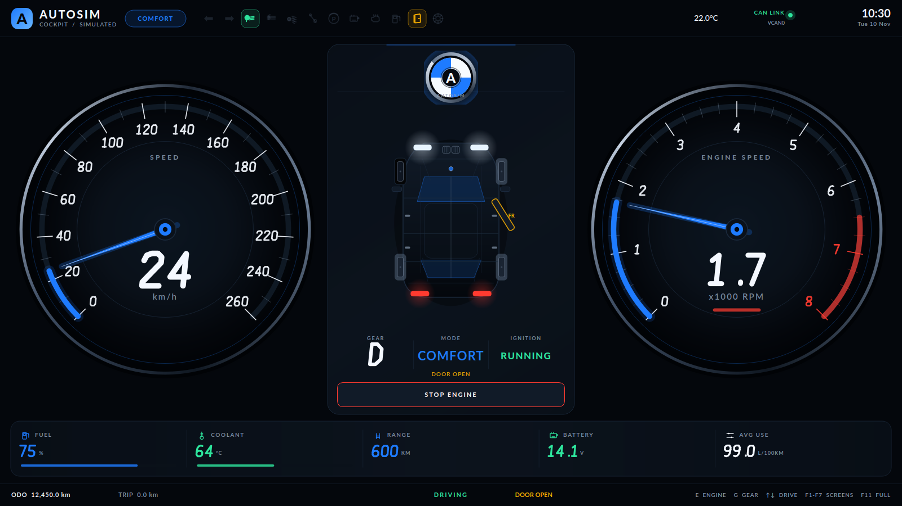
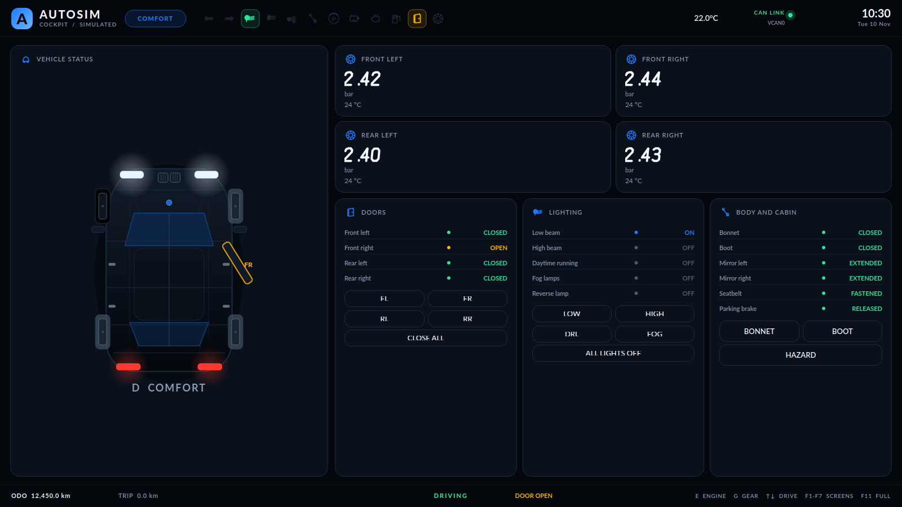
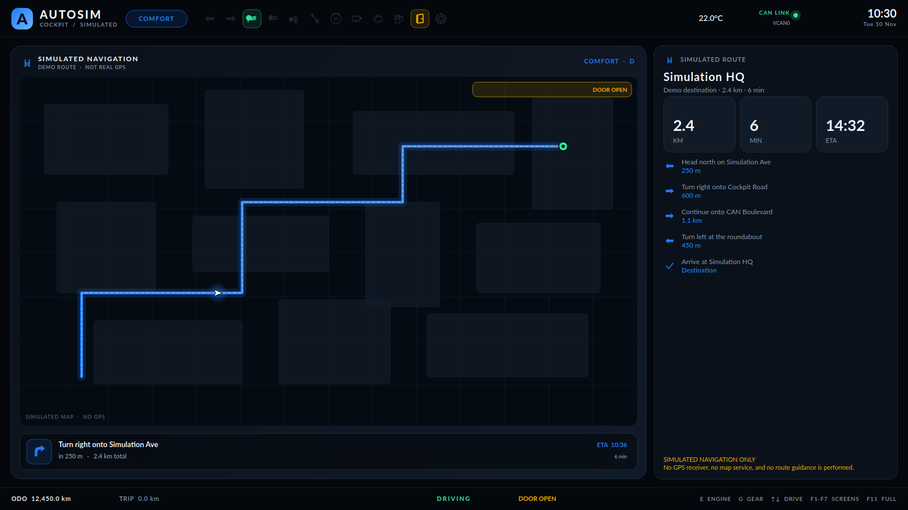
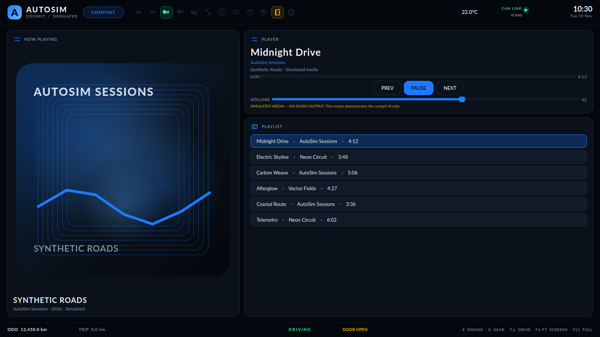
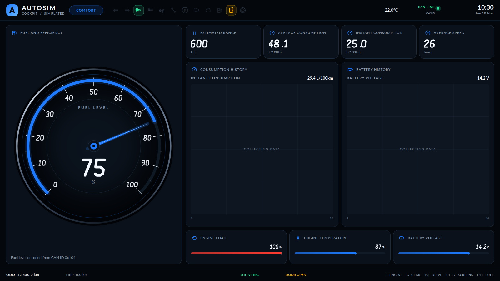
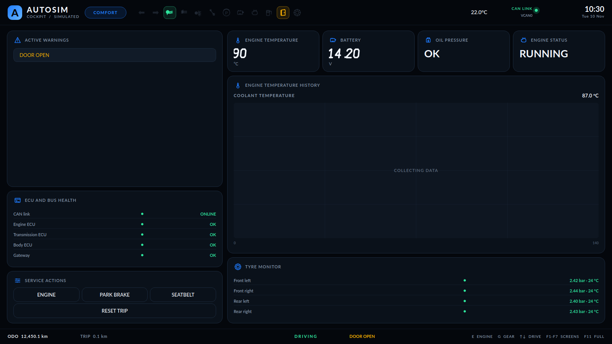
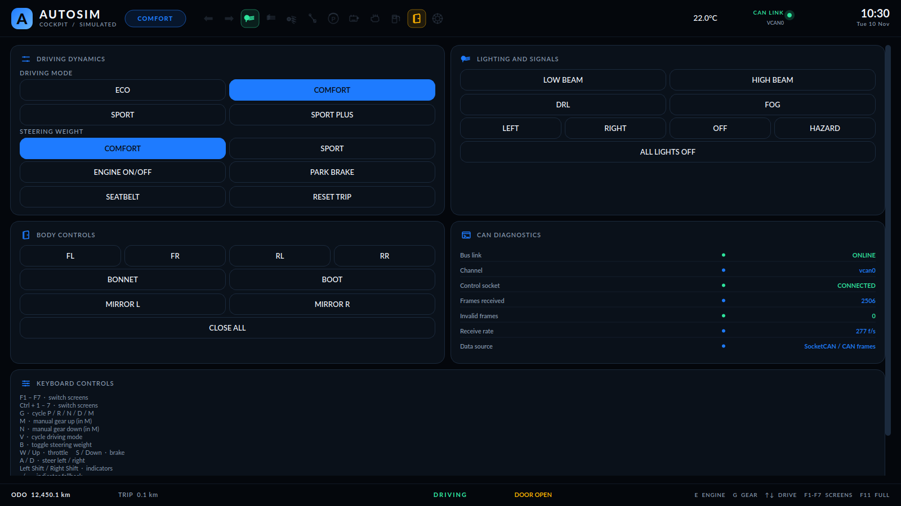
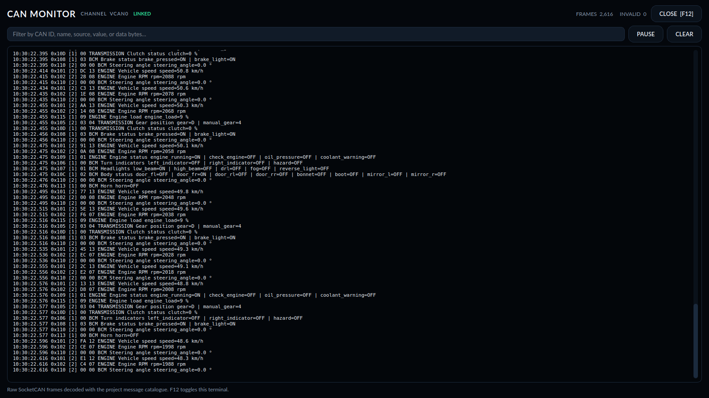

# Screens

At the 1600×900 baseline the UI uses a 66 px header, a flexible screen stack,
and a 40 px footer; header, footer, and cockpit metrics scale with the window
up to 4K. The header shows the brand, driving-mode chip, telltales, clock/date,
CAN link, channel, and ambient temperature. The footer shows odometer, trip,
driving state, first warning, and shortcut hints.

All seven screens retain the last `VehicleSnapshot`, so screen changes render
immediately. The visible screen is refreshed on a 33 ms (~30 fps) tick; header
and footer updates are throttled, and custom widgets skip repainting when their
displayed state has not changed.

## 1. Cockpit (`F1`)

- Large 0–260 km/h speedometer and 0–8000 RPM tachometer with cached painted
  bezels, conical and glass gradients, redline markings, animated needles,
  digital readouts, units, and a `NO CAN DATA` state.
- Central cluster with an original roundel, detailed procedural vehicle
  graphic, engine/gear/driving-mode/link status, warning text, and a clickable
  `START ENGINE` / `STOP ENGINE` button.
- Bottom metric strip: fuel level, coolant temperature, estimated range,
  battery voltage, and average consumption.
- Engine start/stop and gear changes appear as fading toast notifications.
- Warnings appear in the centre cluster, footer, and warning-dependent
  telltales.

## 2. Vehicle (`F2`)

- Top-down procedural vehicle diagram with headlights, high-beam cones, brake
  lights, reverse lamps, indicators, open doors, folded mirrors, and
  bonnet/boot warnings.
- Four tyre cards with pressure, temperature, and warning tint.
- Door status list plus toggle buttons and `CLOSE ALL`.
- Lighting list plus toggles and `ALL LIGHTS OFF`.
- Body/cabin list for bonnet, boot, mirrors, seatbelt, parking brake; hazard
  toggle.

## 3. Navigation (`F3`)

- Reuses the procedural simulated map.
- Demo route card: title, destination, distance, ETA, and turn-by-turn steps.
- Prominent amber disclaimer: simulated navigation only; no GPS, no map
  service, no real route guidance.

## 4. Media (`F4`)

- Procedurally painted album art with concentric rings and a waveform.
- Simulated player with track title, artist, elapsed/duration, progress,
  previous/play-pause/next, volume slider.
- Playlist list; selecting a row loads that track and resumes playback.
- Simulated playback advances only while the Media screen is refreshed.
- Prominent disclaimer: simulated media, no audio output.

## 5. Energy (`F5`)

- Large fuel-level arc gauge decoded from `0x104`.
- Range, average consumption, instant consumption, and average speed cards.
- Consumption history and battery-voltage history charts, sampled every 0.5 s.
- Engine-load, engine-temperature, and battery-voltage bars.
- Range is derived from CAN fuel level using a 60 L tank and 7.5 L/100 km
  reference, explicitly labelled as estimated.

## 6. Service (`F6`)

- Active warning list driven by `VehicleSnapshot.warnings`; green “No active
  warnings” state when empty.
- CAN link/ECU health list. ECU health is reported from CAN link state because
  the dashboard has no direct ECU diagnostics channel.
- Engine temperature, battery, oil-pressure switch, and engine-status cards.
- Engine temperature history chart.
- Tyre monitor with pressure, temperature, and warning state.
- Service actions: engine toggle, parking brake, seatbelt, reset trip.

## 7. Settings (`F7`)

- Driving dynamics: mode buttons (`ECO`, `COMFORT`, `SPORT`, `SPORT PLUS`) and
  steering weight (`COMFORT`, `SPORT`), plus engine/park brake/seatbelt/trip.
- Lighting and signals: lamp toggles, left/right/off indicators, hazard,
  all-lights-off.
- Body controls: doors, bonnet, boot, mirrors, close all.
- CAN diagnostics: link, channel, control-socket connection, frames received,
  invalid frames, receive rate, and data source.
- Keyboard-control help card with the full shortcut reference.

## CAN monitor (`F12`)

- Full-window overlay with channel and link status.
- Frame counter and invalid-frame counter.
- Filter by ID, name, source, value, data bytes, or error text.
- Pause/resume and clear.
- Monospace terminal showing timestamp, ID, DLC, raw bytes, source, message
  name, decoded summary, and invalid-frame errors.
- Shows the last 250 matching frames after a filter rebuild; live mode appends
  queued frames in batches.

## Theme mapping

| Driving mode | Theme |
| --- | --- |
| ECO | Green/black |
| COMFORT | Blue/black |
| SPORT | Red/black |
| SPORT PLUS | Red-orange/black |

A mode change received via CAN switches the stylesheet and custom-painted
widgets on the next UI tick. Charts, gauges, telltales, header, footer, and
monitor repaint with the new palette.
